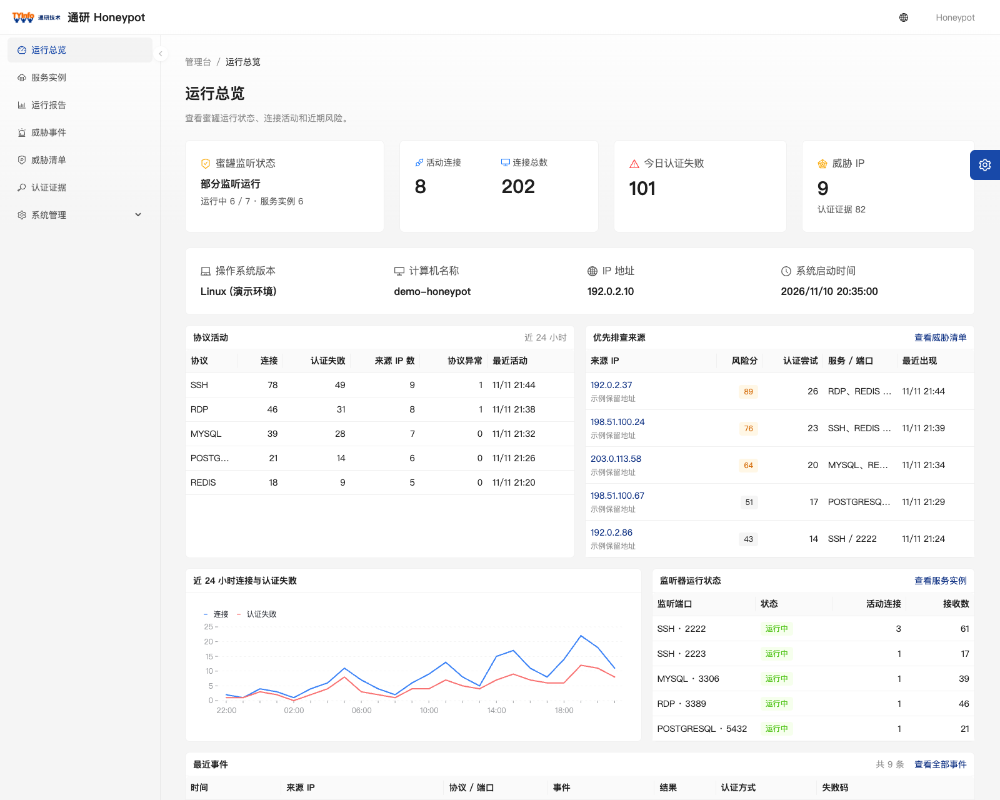
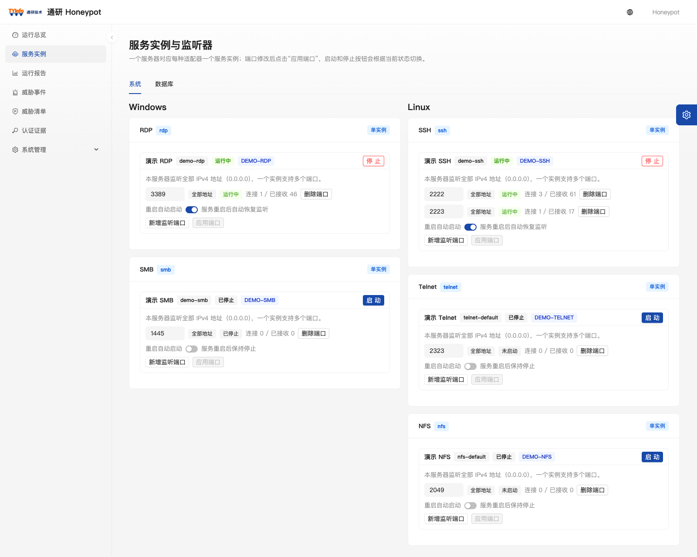
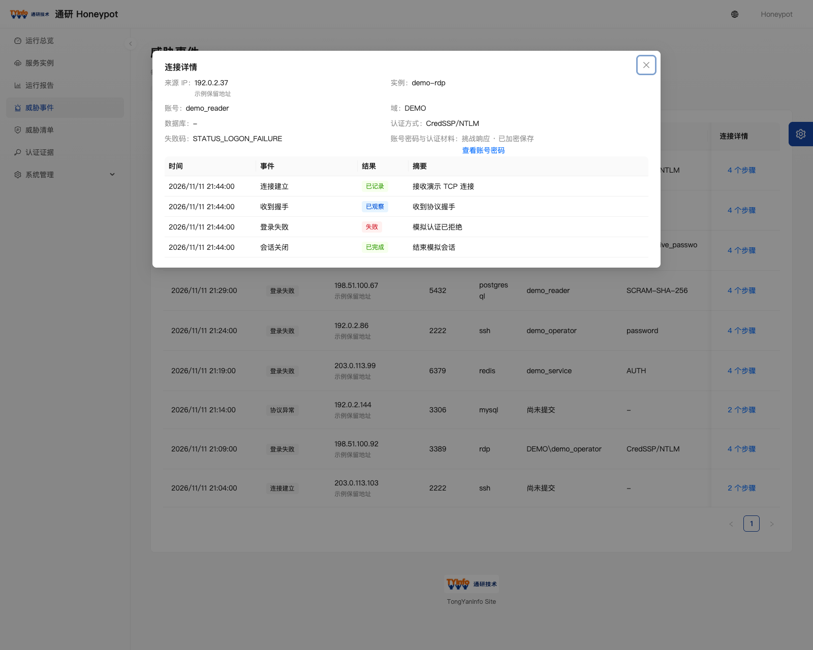
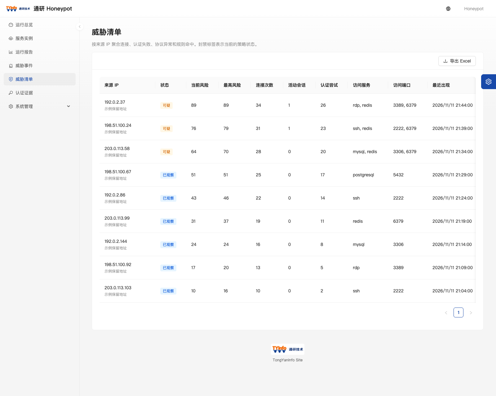
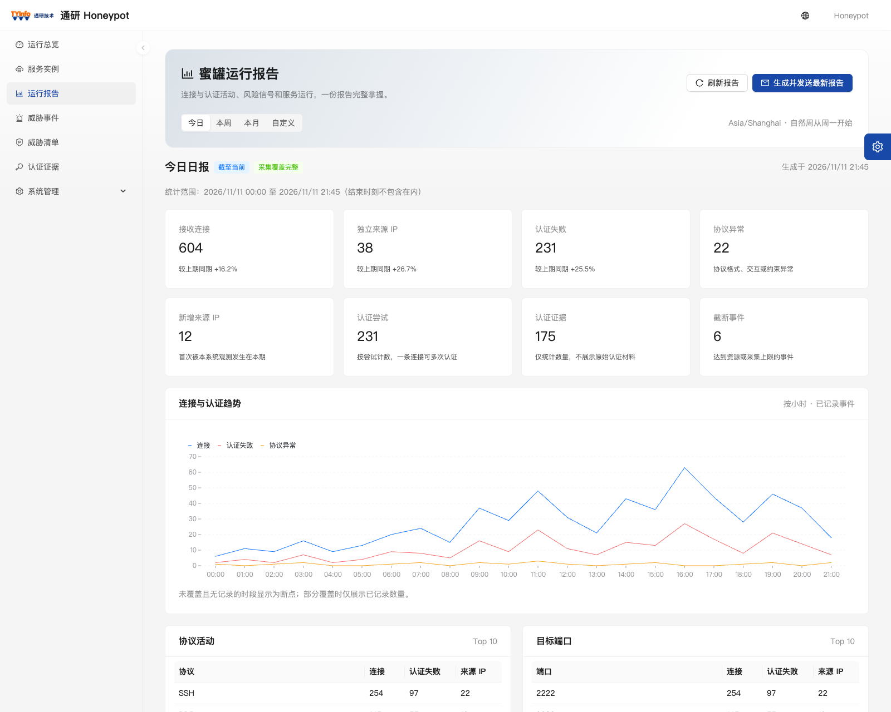
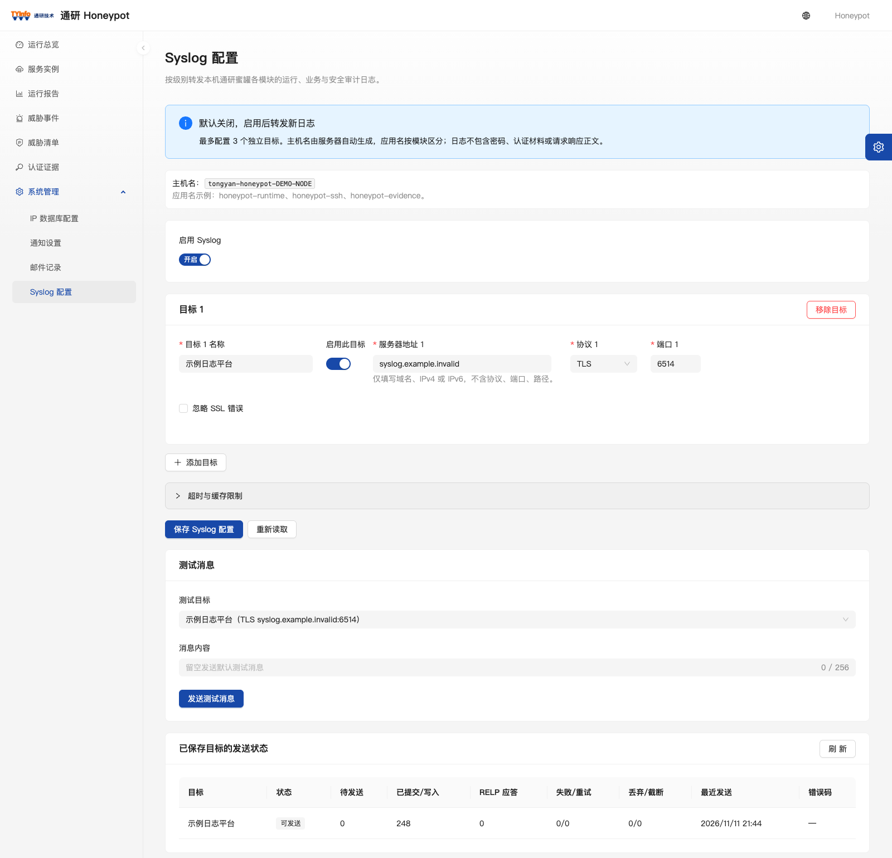

# 通研 Honeypot

**通研官网**：<https://www.tongyaninfo.com>　|　**产品官网**：<https://honeypot.tongyaninfo.com>

通研 Honeypot 是面向隔离网络的单机蜜罐与威胁观测平台。它在指定端口模拟常见服务，记录连接、协议交互和认证尝试，并将同一来源 IP 的活动汇总到威胁清单。运维人员可以从总览定位异常，再回看连接细节、生成运行报告或把日志转发给集中日志平台。

[产品功能](#产品功能) · [快速开始](#快速开始) · [数据与运行边界](#数据与运行边界) · [开发与文档](#开发与文档) · [文档中心](docs/README.md) · [变更日志](CHANGELOG.md)

> 本项目为开源版本，源码以 [Apache License 2.0](LICENSE) 发布，第三方组件与商标说明见 [NOTICE](NOTICE)。
>
> 以下图片截取自实际管理台。截图使用隔离环境和合成数据，地址、账号、主机名和事件均为演示值；来源地址采用文档保留网段（`192.0.2.0/24`、`198.51.100.0/24`、`203.0.113.0/24`）。

当前源码版本为 [0.1.0](VERSION)，处于首批实现阶段，尚未封版。

## 产品功能

### 运行总览

查看实例与监听状态、活动连接、认证失败、威胁 IP 和进程资源。趋势图、协议分布和最近活动帮助定位异常发生的时间与服务。管理台通过 SignalR 刷新运行状态和事件。



### 多协议服务与监听

按协议管理服务实例，为同一实例配置多个监听端口。端口修改采用草稿与应用流程，页面可查看绑定状态、活动连接和错误数，也可设置实例在服务重启后的启动策略。



内置 **16 种协议适配器**：

| 类别 | 协议 |
| --- | --- |
| 远程接入 | SSH、RDP、Telnet |
| 数据库与数据服务 | MySQL、MSSQL、MongoDB、PostgreSQL、Redis、Oracle、Db2、Memcached、HBase、InfluxDB、Elasticsearch |
| 文件共享 | SMB、NFS |

适配器按协议完成受控握手或认证交互，默认按 `AlwaysFail` 策略拒绝认证。NFS 模拟授权拒绝。各协议支持的交互深度和客户端验证范围见 [数据库与系统适配器扩展方案](docs/spec/数据库与系统适配器扩展方案.md) 与 [协议认证补全实施方案](docs/spec/协议认证补全实施方案.md)。

### 威胁事件与来源档案

威胁事件按来源和事件类型查询。打开一条活动即可查看同一连接的事件步骤、目标端口、认证方式和结果，并可导出 Excel。威胁清单按来源 IP 汇总活动次数、风险分、涉及协议和端口，便于从来源回到相关事件。





认证证据列表显示材料类型、采集状态和留存时间。管理员可以按权限查看或导出证据原文，读取操作有审计记录。配置 IP 数据库后，来源地址可异步显示归属地，默认使用通研 IP 适配器（`ip.tongyaninfo.com`），也可通过管理台改为其他兼容数据库。

### 运行报告与邮件通知

按今日、本周、本月或自定义时间查看连接和认证趋势、来源排行、协议分布、资源采样及统计覆盖度。管理员可手动发送报告，或通过 SMTP 订阅日报、周报和月报，并在邮件记录中查询处理状态。



### Syslog 转发

通过 **系统管理 → Syslog 配置** 将蜜罐日志发送到集中日志平台。支持 UDP、TCP、TLS、RELP，最多配置三个目标。报文保留 0–7 级严重级别，主机名使用 `tongyan-honeypot-计算机名`，应用名按模块区分。

可选择已保存的目标发送测试消息。填写单行文本或留空使用默认内容，发送结果显示传输阶段和关联 ID。TLS 默认验证服务端证书。详见 [Syslog 接入与分级方案](docs/spec/Syslog日志接入与全模块分级方案.md)。



### MCP 服务

在 **系统管理 → MCP 服务** 为智能体启用接入并创建 API Key。每个 Key 可单独授予运行总览、威胁调查、报告和实例管理等工具权限。调用记录支持按来源 IP、Key、工具和结果筛选，并可配置留存天数。接入使用同源 `/mcp`，支持 HTTPS 和显式允许的内网 HTTP。详见 [MCP 服务实施方案](docs/spec/MCP%20服务实施方案.md)。

## 快速开始

需要 .NET 10 SDK（以 [global.json](global.json) 为准）、Node.js 22 或更高版本及 npm。以下命令适用于 Bash 或 Zsh。

在项目根目录构建管理台，再使用新的本地数据目录启动应用。页面和 API 共用回环地址：

```bash
(cd frontend && npm ci && npm run build)

honeypot_data_dir="$(mktemp -d)"
dotnet run --project backend/src/Honeypot.Api/Honeypot.Api.csproj --no-launch-profile -- \
  --urls http://localhost:5080 \
  --webroot "$PWD/frontend/dist" \
  --Honeypot:DataDirectory="$honeypot_data_dir"
```

打开 [本地管理台](http://localhost:5080)，按页面提示创建首个管理员。首次启动会在新数据目录中初始化 SQLite。可在另一终端运行 `curl -fsS http://localhost:5080/health` 检查服务。创建服务实例后，请在隔离网络内确认绑定地址和端口再启动监听。

## 数据与运行边界

- **服务仿真**：当前是单机观测版本。适配器提供受控交互，不建立真实 Shell、桌面或数据库会话。风险分用于观测和分析，自动封禁尚未接入。
- **持久化**：SQLite 保存实例与监听配置、报告所需的事件字段、资源采样、报告快照和邮件任务。详细事件、来源风险档案及加密认证证据目前采用进程内存储，服务重启会清空这部分数据。
- **外部投递**：Syslog、SMTP 通知和 IP 归属地查询默认关闭，可由管理员按需要配置。Syslog 转发运行日志、业务事件和审计元数据，认证材料原文仅走受控证据接口。
- **部署**：使用独立数据目录并限制监听范围。应用启动时会执行 SQLite 迁移，升级既有环境前请先备份并核对迁移。
- **证据保护**：攻击者提交的原始密码与认证材料属于取证数据，只进入加密证据仓库，通过权限、留存和审计控制访问，不进入普通日志、指标和接口返回。

## 开发与文档

后端采用 ASP.NET Core、EF Core SQLite 和 SignalR。管理台采用 React、TypeScript、Umi Max 与 Ant Design Pro。

```text
backend/    后端解决方案、协议适配器、运行时、管理 API 和测试
frontend/   管理台页面、路由和 API 客户端
docs/       产品需求、接口说明、设计方案和架构决策
deploy/     部署说明
rules/      规则与风险策略约定
sensors/    传感器与监听运行时约定
scripts/    协议与运行验证脚本
```

```bash
dotnet test backend/Honeypot.slnx

cd frontend
npm run lint
npm test
npm run build
```

- [文档中心](docs/README.md)
- [管理 API 约定](docs/api/README.md)
- [报告与邮件通知方案](docs/spec/报告邮件通知实施方案.md)
- [多协议服务适配与拟真设计](docs/spec/多协议服务适配与拟真设计.md)
- [部署说明](deploy/README.md)
- [变更日志](CHANGELOG.md)
- [安全策略](SECURITY.md)
- [参与贡献](CONTRIBUTING.md)
- [项目开发约定](AGENTS.md)

## 许可

本项目以 [Apache License 2.0](LICENSE) 发布。管理台沿用 Ant Design Pro 模板的部分资产，模板许可文本随仓库保存在 [frontend/LICENSE](frontend/LICENSE)（MIT）。第三方组件适用其各自许可证，详见 [NOTICE](NOTICE)。
