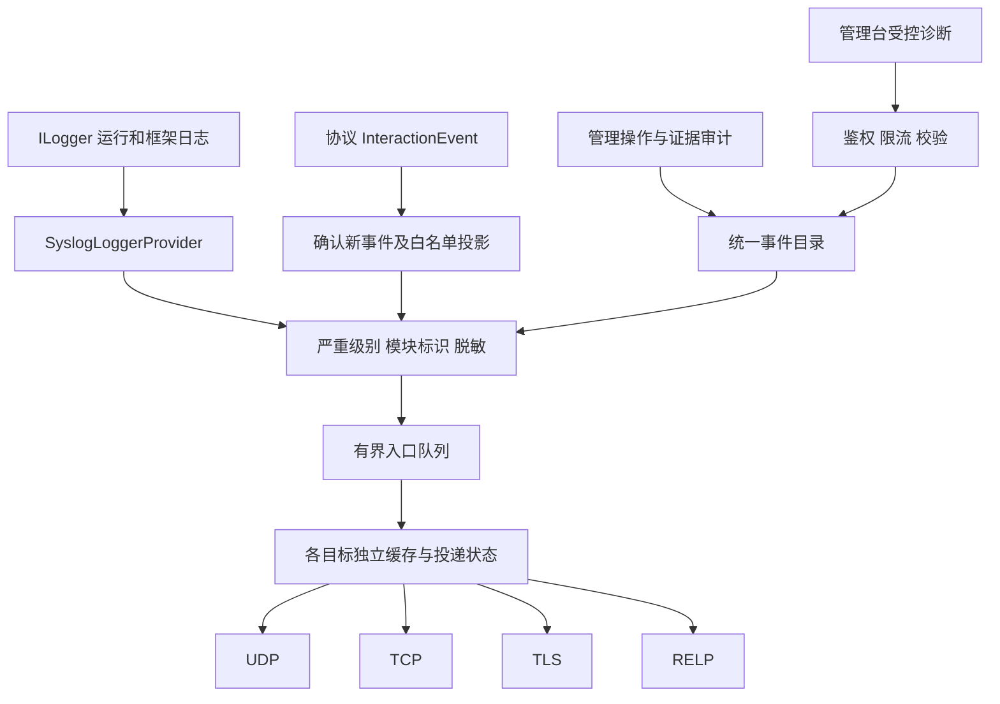

# Syslog 日志接入与全模块分级方案

日期：2026-11-11。状态：**已实现**，验证范围见第 12 节。

## 1. 需求与范围

用户已确认：“本机所有日志”指 **通研蜜罐全部模块的运行、业务和安全审计日志**。不包含宿主 Windows/Linux 系统日志及其他应用日志。

目标如下：

- 系统管理增加“Syslog 配置”，启用后按日志严重级别外发。
- 支持 UDP、TCP、TLS、RELP；多目标配置建议最多 3 个，与参考图一致。目标数上限属于本方案建议值。
- TLS 显示“忽略 SSL 错误”复选框，默认不勾选。
- 启用的目标接收 0–7 级，Facility 固定为 `local0`。
- 接收端主机名列从标准报头 `HOSTNAME` 读取 `tongyan-honeypot-计算机名`。应用名按模块区分，正文省略主机名。
- 纳入后端、协议交互、安全审计、报告邮件、IP 归属地、实时通道和管理台自身异常。浏览器异常需要受控上报接口，不能由服务器日志 Provider 自动取得。

“全部”是指覆盖所有在用模块和应记录的业务结果，不是把密码、原始报文、每次方法调用、数据库参数或浏览器页面内容全部外发。默认覆盖启用后产生的新日志，不自动补发启用前的历史数据。

## 2. 接入前的源码审查

对 `backend/src` 的日志调用、交互事件产生点、异常处理及 DI 注册做静态扫描，并阅读前端实际路由、系统设置、身份、报告、通知和事件相关实现。

| 已存在的能力 | 当前不足及方案影响 |
| --- | --- |
| 默认 .NET 日志体系；后端共有 13 处显式 `LogDebug/LogWarning/LogError` | 没有覆盖业务正常结果和大部分管理审计；仅增加 Provider 不能达到需求。 |
| `InteractionEvent` 与 `IInteractionEventSink` | 连接、认证、握手主要是业务事件，不是 `ILogger` 日志，需要独立白名单投影。 |
| 报告事件 SQLite 持久化、内存事件/威胁视图、SignalR 广播 | 原事件和认证证据仍有内存实现；转发不能被描述为完成证据生产持久化。 |
| 文件型 IP 设置、管理员接口、统一 `ApiResult<T>` | 可以复用设置模式，Syslog 设置不需要新增数据库表。 |
| 证据读取/导出审计 | 目前仅存有界内存队列，需增加安全审计日志输出。 |
| 框架默认级别：`Default=Information`、`Microsoft.AspNetCore=Warning` | Syslog 使用独立的 Provider 级别规则接收 Debug/Trace。 |

当前生产入口的调用关系为：

```text
Program.AddHoneypotRuntime
  → Honeypot.Runtime/Service/TcpListenerHost
  → RealtimeInteractionEventSink
  → ReportInteractionEventStore（报告事实先持久化）
  → InMemoryInteractionEventStore（事件去重、威胁聚合）
  → SignalR 旁路广播
```

依据为 `Program.cs`、`Service/ReportServiceCollectionExtensions.cs`、`Service/RealtimeServiceCollectionExtensions.cs`。仓库另有 `Honeypot.Runtime/Service/impl/TcpListenerHost.cs`，主应用实际注册的是 `Service/TcpListenerHost.cs`；实施时不能修改错链路，也不借此删除旧文件。

## 3. 系统设置设计

新增管理路由 `/system/syslog`，沿用现有主题、`canAdmin` 和服务端管理员校验。

| 字段/操作 | 建议设计 |
| --- | --- |
| 启用 Syslog | 默认关闭；启用时至少有一个合法且启用的目标。 |
| 目标列表 | 建议最多 3 个，向所有启用目标分别投递，不把多个目标当主备。每个目标有稳定 ID、名称和独立状态。 |
| 服务器地址 | 域名、IPv4 或 IPv6；与端口分开填写，不接受 URL 路径、账户信息、控制字符。 |
| 协议 | UDP / TCP / TLS / RELP；新建目标建议 TLS。 |
| 端口 | UDP 514、TCP 514、TLS 6514、RELP 2514；均可改为 1–65535。TCP/RELP 的常用值不是统一标准端口承诺。 |
| 忽略 SSL 错误 | 仅 TLS 显示，`ignoreSslErrors=false`；切换为非 TLS 时服务端归一为 false，切回 TLS 仍默认 false。 |
| 主机标识 | 预览实际报头 `tongyan-honeypot-计算机名`。 |
| 超时与缓存 | 连接和写入分别默认 10 秒。高级设置可调整超时、积压配额和保留时间。 |
| 保存 | 后端校验、原子保存并热生效；保存配置不等于测试投递成功。 |
| 发送测试消息 | 选择已保存目标，填写最多 256 个字符的单行消息或留空使用默认消息。结果显示关联 ID 和实际传输阶段。总开关关闭时也可发送单条测试。UDP 报文超出字节预算时提示缩短消息。 |
| 运行状态 | 每目标显示禁用/连接中/可用/退避/故障、最后发送/确认时间、待发送数、失败/重试/丢弃/截断数、最近脱敏错误码。UDP 显示“本地提交”而非“连接正常”。 |

协议切换时，表单保留自定义端口。旧配置中的级别过滤及 Facility 字段在读取时归一为全部级别及 `local0`。

拟定 API：

| 接口 | 作用与权限 |
| --- | --- |
| `GET /api/v1/settings/syslog` | 管理员读取配置和配置版本，禁止缓存。 |
| `PUT /api/v1/settings/syslog` | 管理员保存；版本不匹配返回 409，校验失败返回 400，写入失败返回 500。 |
| `POST /api/v1/syslog/test` | 管理员提交 `targetId` 和可选 `message`。目标必须已保存，接口限制频率、超时和并发并返回传输阶段。 |
| `GET /api/v1/syslog/status` | 管理员读取每目标发送状态与统计。 |
| `POST /api/v1/telemetry/frontend-logs` | 已登录用户上报受控前端诊断；服务端重新校验和确定严重级别，不能由客户端指定任意目标或 0/1 级。 |

业务接口统一返回 `ApiResult<T>`，保留真实 HTTP 状态码；前端按钮控制不能替代后端鉴权。

配置保存至 `Honeypot:DataDirectory/syslog/settings.json`，复用 IP 设置的限量读取、写锁、临时文件原子替换及变更通知模式。读取损坏配置时关闭外发、保留原文件并给出本地错误状态；不得静默覆盖。此方案不新增数据库表，不修改 `.env` 或真实密钥。

## 4. 协议与 TLS 行为

消息统一采用 RFC 5424 格式，传输层按协议分别实现。

| 协议 | 发送方式 | 成功含义及限制 |
| --- | --- | --- |
| UDP | 一条消息一个数据报；限制报文大小，避免分片 | 无确认、无顺序或送达保证；本地发送返回不表示接收端收到。 |
| TCP | 长连接；RFC 6587 octet-counting，即 `UTF-8字节长度 空格 消息` | 写入完成只说明本地传输进展；断线时可能丢失或重复，不能宣称远端持久化。 |
| TLS | TLS 长连接；RFC 5425 的 octet-counting | 加密并校验服务端身份，仍没有每条 Syslog 的应用确认。 |
| RELP | 真正实现 `open/syslog/rsp/close`、事务号、应答和未确认消息重发 | 收到对应 ACK 才标记已确认；ACK 的持久化含义取决于接收端。ACK 丢失后重发可能重复。 |

协议依据：[RFC 5426](https://www.rfc-editor.org/rfc/rfc5426)、[RFC 6587](https://www.rfc-editor.org/rfc/rfc6587)、[RFC 5425](https://www.rfc-editor.org/rfc/rfc5425)、[librelp 协议](https://raw.githubusercontent.com/rsyslog/librelp/master/doc/relp.md)、[rsyslog imrelp](https://docs.rsyslog.com/doc/configuration/modules/imrelp.html)。TCP 514 和 RELP 2514 为本方案采用的常见配置值。

TLS 明确规则：

1. 默认校验证书链、有效期和目标名称；IP 地址连接也按 IP SAN 验证，不静默跳过名称验证。
2. 默认使用平台支持的安全 TLS 策略，目标支持 TLS 1.2/1.3、优先 1.3，不使用 0-RTT；不照搬旧 RFC 的过时密码套件。依据 [RFC 9662](https://www.rfc-editor.org/rfc/rfc9662)。
3. 勾选“忽略 SSL 错误”只放宽当前目标的证书验证，不修改进程全局验证，不降级为明文。握手失败、协议不兼容、服务器要求但未提供客户端证书仍然失败。
4. 勾选状态在页面持续显示“未验证服务器身份”，false→true 记录 Warning(4) 审计。普通保存无需增加重复确认弹窗。
5. 首版 TLS 为服务端认证；如现场要求双向 TLS，再单独制定客户端证书/私钥配置与授权方案。RELP 首版明确为 RELP over TCP，不能因使用 RELP 就宣称加密；RELP over TLS 需要额外配置与验收。
6. 多目标不得共享错误的证书回调或连接状态。目标改协议、主机或证书策略后关闭旧连接，后续发送使用新配置快照。

RELP 是本需求的交付项，不能用“普通 TCP + RELP 名称”替代。实现前确认可维护的库或受限协议实现路径，必须和真实 librelp/rsyslog 互通，完成后再开放页面选项。

## 5. 主机名、应用名及消息格式

### 5.1 标准报头主机名

RFC 5424 的报头采用 ASCII，HOSTNAME 上限为 255 个可打印字符，APP-NAME 上限为 48 个。计算机名取自 `Environment.MachineName`，在容器内取运行环境报告的名称。[RFC 5424 §6](https://www.rfc-editor.org/rfc/rfc5424#section-6)

| 字段 | 示例与处理 |
| --- | --- |
| 标准报文 `HOSTNAME` | `tongyan-honeypot-SERVER01`。有非 ASCII 字符或超长的计算机名归一化并附稳定摘要，降低截断碰撞风险。 |
| 接收端“主机名”列 | 直接读取标准报头 `HOSTNAME`。 |
| `APP-NAME` | 使用第 7 节的固定模块名。 |
| JSON 正文 | 省略主机名和主机显示名字段。 |

### 5.2 统一记录合同

- 报头：`PRI`、版本 1、UTC 时间、HOSTNAME、APP-NAME、进程 ID、稳定的事件代码 MSGID、合法 STRUCTURED-DATA（无需自定义 SD 时使用 `-`）。RFC 5424 时间的小数部分最多 6 位，不能直接使用默认包含 7 位小数的 .NET `ToString("O")` 作为报头时间。
- `PRI = facility × 8 + severity`；例如 local0 + Notice 为 133。[RFC 5424 §6.2.1](https://www.rfc-editor.org/rfc/rfc5424#section-6.2.1)
- MSG 为白名单 JSON；若使用 RFC 5424 的 MSG-UTF8 分支，按标准处理 UTF-8 BOM，并验证接收端解析。TCP/TLS 的 MSG-LEN 为完整 Syslog 消息字节数（含实际 BOM、不含长度前缀）；RELP 的 DATALEN 为该命令 DATA 字节数，不含 RELP 头、分隔空格和结尾 LF。均不能按字符数计算。
- 基础字段包括 `schemaVersion / logId / eventCode / severity / occurredAtUtc`。`category / outcome / errorCode` 随来源提供。
- 按场景可选：`eventId / connectionId / sequence / traceId / listenerId / serviceInstanceId / adapterKey / sourceIp / sourcePort / destinationIp / destinationPort / actorUserId / username / domain / database / authenticationMethod / authenticationFailureCode / authenticationAttempt / materialType / credentialCaptureStatus / credentialArtifactId / riskScore / riskDelta / closeReason / persistenceOutcome / truncated`。认证事件至少保留已采集的用户名/域、认证方法、失败码、次数、存证状态和证据引用；没有采集到的字段保留未知，不能捏造。
- 事件复用既有 `eventId`，新增日志 ID 通过现有集中 `IResourceIdGenerator` 的统一入口生成；重试保留原 ID，不让每个模块各自发号。
- 日志严重级别与风险评分分别存储；高风险 IP 不自动变成 Critical，Block 决策也不等于已经执行防火墙封禁。

示意字段（不是实际发送记录）：

```json
{
  "eventCode": "AUTHENTICATION_ATTEMPTED",
  "severity": 5,
  "outcome": "rejected_by_policy",
  "authenticationFailureCode": "AUTH_FAILED",
  "credentialArtifactId": "<artifact-id>"
}
```

## 6. 严重级别统一规则

数值越小，严重程度越高。0、1、2 必须由明确故障条件触发，不能按异常类型、英文单词 failure 或攻击次数简单推断。

| 数值 | 名称 | 本项目使用条件 |
| --- | --- | --- |
| 0 | Emergency / 紧急 | 已确认整个应用无法继续可靠运行且无可用降级路径，需立即恢复全局服务；极少触发。 |
| 1 | Alert / 警报 | 已确认安全边界或审计完整性遭破坏、材料泄露等必须立即干预的事件；当前不存在的检测能力不能虚构日志。 |
| 2 | Critical / 严重 | 核心采集/存证持续不可用、全部应运行监听器异常失效、关键启动依赖失败。 |
| 3 | Error / 错误 | 当前操作明确失败：监听绑定失败、事件或证据写入失败、报告生成失败、邮件最终失败。 |
| 4 | Warning / 警告 | 可恢复故障、重试、资源限额、权限拒绝、管理登录失败、达到明确规则的异常行为。 |
| 5 | Notice / 通知 | 重要且符合设计的结果：蜜罐认证拒绝、配置修改、实例启停、管理员登录退出、证据读取/导出、故障恢复。 |
| 6 | Informational / 信息 | 连接建立/正常结束、一般运行状态、报告生成和邮件受理等正常处理结果。 |
| 7 | Debug / 调试 | 握手步骤、协议协商、缓存命中、诊断细节、正常轮询和计划取消；仍禁止敏感材料。 |

级别名称依据 [RFC 5424](https://www.rfc-editor.org/rfc/rfc5424)。以上触发条件是本项目拟定的应用语义。

既有 .NET 日志采用显式映射：

| .NET LogLevel | Syslog |
| --- | --- |
| Trace、Debug | 7 |
| Information | 6 |
| Warning | 4 |
| Error | 3 |
| Critical | 2 |
| None | 不输出 |

0、1、5 由统一事件目录/结构化事件定义显式指定；保留原 .NET 级别供诊断，不能用枚举数值强转。通用 ILogger 只按上表映射，不根据消息文本猜测级别。

Syslog Provider 独立接收全部候选级别。框架日志按字段白名单外发，未知模板仅输出分类、事件号和安全摘要。Provider 级别机制参见 [.NET 日志文档](https://learn.microsoft.com/en-us/aspnet/core/fundamentals/logging/?view=aspnetcore-10.0)。

## 7. 全模块日志矩阵

以下应用名均为固定 ASCII 标识且小于 48 字符。普通函数不逐一添加无意义日志，按业务边界记录一次结果，重要状态变化记录开始/结果或失败/恢复。

| 模块 / APP-NAME | 应记录的正常事件 | 异常及级别 |
| --- | --- | --- |
| 宿主 `honeypot-host` | 启动、就绪、正常关闭、恢复完成 5；运行摘要 6；资源采样细节 7 | 关键启动依赖失败 2；明确全局不可用 0；普通取消 7。 |
| 管理 API `honeypot-api` | 普通业务请求摘要 6；健康检查/列表轮询 7 | 参数无效 6；权限拒绝 4；未处理服务端错误 3；使用路由模板而非含查询参数的原始 URL。 |
| 身份 `honeypot-identity` | 首次初始化、登录成功、主动退出 5；会话自然过期 6 | 管理登录失败/越权 4；用户存储损坏且认证不可用 2。 |
| 系统设置 `honeypot-settings` | IP/SMTP/订阅/Syslog 保存、开关及配置版本改变 5 | 开启忽略 TLS 验证 4；写入失败 3；非核心可恢复配置降级 4。 |
| 实例/监听 `honeypot-runtime` | 实例创建、草稿应用、启动/停止、自动启动策略修改、恢复 5；连接建立/结束 6 | 绑定/accept 故障 3；资源限制 4；全部应运行监听失效 2；客户端断开/计划取消 7。 |
| 事件 `honeypot-events` | 新事件接收 6；重复事件识别 7 | 单次拒收/持久化失败 3；持续核心采集不可用 2。 |
| 判定/威胁 `honeypot-engine` | 规则决策预览/普通评分计算 7；首次可疑状态变化 5；明确阈值命中 4 | 算法内部异常 3；状态、风险分与执行结果分别记录，不能记录不存在的“封禁成功”。 |
| 存储 `honeypot-storage` | 既有初始化/迁移开始完成 5；维护摘要 6 | 可重试争用 4；读写明确失败 3；关键存储整体不可用 2。不记录 SQL 参数。 |
| 认证证据 `honeypot-evidence` | 保存元数据 6；原文读取/导出成功 5；过期访问 6 | 未授权访问 4；加密/解密/容量/保存失败 3；持续无法存证 2。绝不输出原文。 |
| 运行报告 `honeypot-report` | 生成、冻结快照、周期入队完成 6；手动发送/订阅修改 5 | 单次采样缺失 4；持续采集空窗/生成失败 3；数据未知保留未知。 |
| 邮件 `honeypot-mail` | 任务排队、SMTP Accepted 6；人工重试 5 | Retrying/Unknown 4；最终 Failed、TLS/认证/保护密钥故障 3；Accepted 只能写“服务器受理”。 |
| IP 归属地 `honeypot-iplocation` | 缓存/查询细节 7；恢复 5 | 单次查询失败 6；连续依赖失败/队列饱和 4；内部意外异常 3。 |
| 实时通道 `honeypot-realtime` | 连接/正常断开 7；恢复 5 | 单次客户端断连 7；连续广播降级 4；内部逻辑异常 3。 |
| 管理台 `honeypot-webui` | 页面状态诊断 7；恢复 5 | 页面崩溃/导出生成失败 3；持续实时断连 4；浏览器离线 6；正常表单校验 7。 |
| Syslog `honeypot-syslog` | 启用/关闭/配置生效/恢复/测试 5；积压摘要 6 | 连接重试 4；证书拒绝、明确发送失败、实际丢弃 3；自身失败不得递归入发送队列。 |

### 7.1 全部 16 个协议

来源：`Honeypot.Protocols.Builtin/ServiceCollectionExtensions.cs` 的当前注册清单。

| 协议 | APP-NAME | 分级中特别需要保留的语义 |
| --- | --- | --- |
| SSH | `honeypot-ssh` | 密码/交互认证拒绝 5；banner、密钥交换阶段 7。 |
| RDP | `honeypot-rdp` | CredSSP/NTLM 拒绝 5；X.224/TLS/挑战步骤 7；不宣称远程桌面登录成功。 |
| MySQL | `honeypot-mysql` | native/full-auth 拒绝 5；RSA/TLS 阶段 7；材料类型保留为元数据。 |
| MSSQL | `honeypot-mssql` | SQL/SSPI 拒绝 5；PRELOGIN/TLS 阶段 7。 |
| MongoDB | `honeypot-mongodb` | SCRAM 拒绝 5；hello/协商 7；挑战响应不得标为明文密码。 |
| PostgreSQL | `honeypot-postgresql` | 密码认证拒绝 5；startup/TLS 7。 |
| Redis | `honeypot-redis` | AUTH/ACL 尝试拒绝 5；RESP 解析细节 7。 |
| Oracle | `honeypot-oracle` | Oracle Net/TTC 认证拒绝 5；握手 7。 |
| Db2 | `honeypot-db2` | DRDA 认证拒绝 5；协商 7；超时与实现异常分别分类。 |
| Memcached | `honeypot-memcached` | SASL 拒绝 5；二进制协商 7。 |
| HBase | `honeypot-hbase` | SASL 拒绝/要求认证 5；RPC preamble 7。 |
| InfluxDB | `honeypot-influxdb` | HTTP 认证拒绝 5；不输出 Authorization、URL 凭据或请求正文。 |
| Elasticsearch | `honeypot-elasticsearch` | HTTP 认证拒绝 5；不把蜜罐返回 401 当管理 API 故障。 |
| Telnet | `honeypot-telnet` | 账号密码尝试拒绝 5；协商 7；输入正文不入日志。 |
| SMB | `honeypot-smb` | NTLM 拒绝 5；方言协商 7。 |
| NFS | `honeypot-nfs` | 授权拒绝 `AuthorizationDenied` 5；RPC/XDR 协商 7；不声称取得密码。 |

所有协议共用以下规则，不复制 16 套分级代码：

| 事件/条件 | 级别 |
| --- | --- |
| `ConnectionAccepted`、真实正常 `SessionClosed` | 6 |
| `AuthenticationAttempted` + AlwaysFail、`AuthorizationDenied` | 5 |
| `BannerSent / HandshakeReceived / PreLoginResponseSent / TlsHandshakeCompleted / SspiChallengeSent / CredSspChallengeSent / X224ConnectionConfirmSent / AuthenticationMethodsRequested` | 7 |
| 单次客户端握手超时、正常取消/断开 | 7；来源滥用满足明确规则时另产 4 级告警事件。 |
| 畸形报文、未知认证方法、不支持的协议 | 5；持续异常或资源滥用 4。 |
| `ResourceLimitExceeded` | 4 |
| `CredentialCaptureFailed / AuthenticationEventWriteFailed` 或等价存证/事件失败 | 3；持续核心不可用升级为单独 2 级状态事件。 |
| 适配器内部未预期异常 | 3，不能与攻击者提交的非法数据混为一类。 |

未知事件代码默认 6 并记录分类缺口；新增协议/事件必须补齐目录和用例。攻击次数或 RiskDelta 不自动把 5 升为 2；需要升级时产生独立、可追溯的规则命中日志。

未注册的旧运行时实现和未挂载的前端模板页面不作为当前在线模块宣称已覆盖；若重新启用，必须先接入同一事件目录和验收，不允许形成第二套分级规则。

### 7.2 现有 13 个显式日志调用的调整清单

以下路径相对于 `backend/src`，行号是本次静态检查时的位置。

| 现有位置 | 当前级别 | 拟处理 |
| --- | --- | --- |
| `Honeypot.Runtime/Service/TcpListenerHost.cs:251` | Error | accept 循环失败保持 3，异常改为安全摘要。 |
| `Honeypot.Runtime/Service/TcpListenerHost.cs:349` | Warning | 拆分存储/内部故障 3、资源滥用 4、客户端取消/断开 7。 |
| `Honeypot.Api/Workers/ServiceInstanceRecoveryWorker.cs:41` | Error | 恢复失败保持 3；按聚合状态识别全部应运行实例不可用 2。 |
| `Honeypot.Api/Workers/ServiceInstanceRecoveryWorker.cs:47` | Error | 保持 3；禁止异常全文泄露配置/材料。 |
| `Honeypot.Api/Workers/RealtimeSnapshotWorker.cs:52` | Debug | 单次客户端瞬断 7；持续降级 4；内部异常 3。 |
| `Honeypot.Api/Service/impl/SignalRRealtimeUpdateNotifier.cs:59` | Debug | 同上，确定唯一故障归属点，避免重复记录。 |
| `Honeypot.Api/Service/impl/RealtimeInteractionEventSink.cs:46` | Debug | 同上；广播故障不改变已保存事件的接收结果。 |
| `Honeypot.Api/Workers/NotificationDeliveryWorker.cs:17` | Warning | 可恢复故障 4；邮件最终失败由服务层记录 3。 |
| `Honeypot.Api/Workers/ReportScheduleWorker.cs:16` | Warning | 可恢复调度失败 4；周期任务明确失败 3。 |
| `Honeypot.Api/Workers/ReportRuntimeSamplerWorker.cs:76` | Warning | 单次采样缺失 4；持续空窗 3，恢复 5。 |
| `Honeypot.Api/Common/NotificationEndpoints.cs:130` | Warning | 当前请求已失败应为 3；与底层已记录异常关联去重。 |
| `Honeypot.Api/Service/impl/ReportInteractionEventStore.cs:54` | Warning | 已拒收事件，改为 3；持续核心采集失败另记 2。 |
| `Honeypot.Api/Service/impl/FileIPLocationSettingsStore.cs:34` | Warning | 非核心配置关闭降级保留 4；人工保存失败另记 3。 |

还要补齐没有 ILogger 的身份/设置/实例动作、邮件投递结果、证据审计、IP 解析持续故障、威胁状态变化等，不能把上表当作全部改造范围。

## 8. 接入架构与关键修正



实施要点：

1. **运行日志、业务事件、审计三路接入。** Provider 负责已有日志；交互事件在报告事实确认新接受后白名单投影；管理操作在真正执行成功或失败的服务边界产生一次审计。网络 IO 不进入协议握手、请求或 ILogger 同步调用。
2. **先辨别新事件和重复事件。** 当前报告和内存层对重复事件也返回 `Accepted`。需在 `EventAppendResult` 增加明确的重复标志/接收结果，或采用统一可靠去重入口；不能解析 message 文本，也不能仅看 Recorded 就重复外发。
3. **修正最终关闭原因。** Runtime 当前在适配器返回后可能统一记录 completed，HTTP 数据库适配器会吞掉存证异常。统一传递真实 `SessionCloseReason`，每个会话只产生一次最终关闭结果，覆盖存储降级、超时、资源限额和早退；先修正事实，再映射级别。
4. **失败诊断不依赖失败的事件库。** 事件/证据写入失败走独立安全运行日志入口，记录固定错误码、关联 ID 和计数；不能再只尝试通过同一故障 sink 记录失败。
5. **分级归属固定。** SMTP 结果由邮件服务记录，worker 只兜底未分类失败；协议事件由投影器负责，Provider 不再复制同一记录；中间件记录请求结果并关联 traceId，不重复输出完整业务失败。
6. **引擎保持纯逻辑。** 不把网络或日志传输依赖引入 `Honeypot.Engine`，由调用方对决策和状态变化记录日志。
7. **启动与关闭也覆盖。** 日志入口在数据库初始化、实例恢复前可用；配置加载不得依赖尚未构造的 Logger 形成循环依赖。启动记录先入有界缓冲，致命启动失败同时写本地安全出口；正常退出有截止时间地排空已接受队列。
8. **管理台只上报必要诊断。** 统一错误边界、请求异常、导出失败、SignalR 状态变化使用模块事件码；限量、限频、去重，故障上报失败不再产生新的上报。不能上传表单、DOM、下载数据、原始堆栈或完整 URL；登录前及网络完全中断的浏览器故障不保证可传回服务器，服务端登录审计独立存在。

实现位置：

| 路径 | 职责 |
| --- | --- |
| `Honeypot.Shared/Models/SyslogModels.cs` | 配置、严重级别、状态及跨层日志合同。 |
| `Honeypot.Api/Service/ISyslogSettingsStore.cs`、`ISyslogPublisher.cs`、`ISyslogTransport.cs` | 设置、非阻塞提交和传输接口。 |
| `Honeypot.Api/Service/impl/` | 文件设置、Provider、入口队列、协议传输和本地暂存。 |
| `Honeypot.Api/Common/` | RFC 格式化、交互事件投影、分级、设置校验与 API。 |
| `Honeypot.Api/Middleware/` | 请求结果、异常和关联 ID 日志；复用现有鉴权结果。 |
| `Honeypot.Api/Workers/SyslogDeliveryWorker.cs` | 异步发送、退避、恢复与状态统计。 |
| `frontend/src/pages/system/syslog/` | 设置、测试和状态 UI。 |
| `frontend/src/services/honeypot/syslog.ts` | 统一业务 API；前端诊断放公共服务入口。 |
| 现有 Runtime/Protocols/Common/Api 服务 | 修正事实和补齐日志，复用现有业务处理，不另起第二套采集流程。 |

## 9. 可靠性、容量与外发边界

- 每目标独立队列/连接/退避，一台不可达不拖慢其他目标。生产主链路只做白名单构造和有界入队，不能等待 DNS、TLS 或网络发送。
- 文件暂存默认每目标 256 MiB、保留 24 小时。入口默认 10,000 条，以 16 MiB 的估算日志字节预算限制。容量和保留时间可在高级设置调整，现场吞吐以负载测试为准。
- 区分“已入内存队列”“已写本地暂存”“本地传输完成”“RELP 已确认”。异步落盘前的进程崩溃可能丢失内存尾部；UDP/TCP/TLS 也无法证明远端落盘，任何协议都不承诺无条件零丢失或 exactly-once。
- 对已安全暂存且未完成发送的记录保留稳定 ID，重启后恢复；RELP 对未确认记录重发。接收端可按 `logId/eventId` 去重。
- 缓存达到上限时优先淘汰低级别日志，保留高严重度及审计容量；仍无空间时明确累计丢弃计数、丢弃级别和时间范围。不能无限占盘、阻塞蜜罐或静默丢弃。
- 默认不抽样业务/安全审计。重复基础设施故障可按“首次失败 + 周期摘要 + 恢复”记录；普通连接/认证尝试不能在未说明的情况下被采样。
- 总开关关闭后停止新外发和重试，保留已有受控暂存至保留期限；关闭操作本地留痕。重新启用同一目标可恢复其未过期积压，明确显示待发送数量；启用前从未采集的历史日志不会补回。
- 每条暂存绑定目标 ID、地址、端口、协议、证书校验策略和 Facility。修改这些字段后旧积压进入暂停状态，恢复原配置时可续发。状态页显示暂停数量及因过期或容量限制丢弃的数量。
- 超长记录先截断非核心字段，保留 eventId、级别、模块、错误码并标记 truncated；不切断 UTF-8 字符或破坏 JSON。UDP 采用较小报文上限并做网络联调，必要时用短摘要关联同一 ID。
- Syslog 自身故障使用独立本地诊断/状态计数，传输失败诊断不能再次无条件进入自身队列。恢复后可向可用目标发送一次积压/丢失摘要。
- 不自动抓取 Console 输出文件，避免“Provider 转发 + 文件再采集”重复。现有本地日志策略保留，Syslog 是新增外发通道。

## 10. 内容保护与注入防护

1. 密码、私钥、完整票据、挑战响应原文、证据正文、SMTP 授权码、连接串、Authorization/Cookie/Token 不进入 Syslog。保留 `credentialArtifactId` 和材料类型等元数据。
2. 不对 `InteractionEvent`、证据对象、配置对象或异常直接调用 `ToString()`/整对象序列化；`Password` 的 JsonIgnore 不能保护任意日志格式化路径。
3. `PayloadSummary` 不是天然安全字段，例如 SSH 客户端版本来自攻击者。默认使用固定模板及白名单属性，对可用的外部文本限长、编码并移除控制字符。
4. 特别清理 SignalR URL 的 `access_token`，框架/HttpClient 的完整 URL、请求响应体、EF 参数和异常内嵌内容。未审查模板只保留安全元数据。
5. 配置修改审计只保存字段名、版本、操作人及安全结果；不记录整个设置对象。用户名/来源 IP 等观测字段按明确白名单外发，仍受目标权限及留存控制。
6. Syslog 字节编码、JSON 转义、长度前缀和控制字符处理统一实现，验证换行、NUL、引号、方括号和恶意长字符串不能伪造第二条日志。

## 11. 实施顺序与验收

四种协议和全模块分级采用以下实施顺序。

1. 建立统一事件目录、0–7 分级、模块映射和字段白名单；完善重复接收标志与最终关闭原因。
2. 完成设置/API/前端、文件存储、Provider、业务事件投影、审计入口及 Provider 级别规则。
3. 完成 UDP/TCP/TLS/RELP Transport、有界暂存、热更新、状态及自诊断。
4. 按第 7 节补齐全部模块日志；加入管理台受控诊断，逐条校对严重级别。
5. 隔离自动化验证及目标接收器联调，形成实际结果记录，再决定部署。

| 验收范围 | 必须验证 |
| --- | --- |
| 设置与权限 | 默认关闭、TLS 忽略错误默认 false、管理员权限、非法地址/端口/超大请求、版本冲突、保存失败保留旧配置。 |
| 八级日志 | 0–7 各一条，Facility 为 `local0`。验证旧设置中的级别过滤归一化和 Debug/Trace 的独立采集。 |
| 发送测试消息 | 管理员选定已保存目标，验证默认或自定义正文、关联 ID、单行长度校验和 UDP 报文预算。 |
| 协议解析 | 独立接收器解析 PRI、时间、HOSTNAME、APP-NAME、MSGID、JSON；TCP 粘包/拆包及字节长度；UDP 大小上限。 |
| TLS | 可信证书成功；未知 CA、过期、名称不符默认失败；勾选后仅当前目标放宽；不得明文降级；协议切换复位。 |
| RELP | open 协商、事务号、ACK、非成功应答、ACK 超时、断线重发、ACK 丢失重复窗口；和 rsyslog/librelp 实测。 |
| 主机/应用列 | 目标平台解析 `tongyan-honeypot-计算机名` 和各模块应用名。覆盖非 ASCII 机器名及长度限制，正文省略主机名。 |
| 全协议语义 | 16 个适配器 AlwaysFail 均为 5；NFS 授权拒绝为 5；握手为 7；存证失败为 3；最终关闭原因准确。 |
| 全业务语义 | 管理登录失败 4、证据越权 4、初始化/配置/启停 5、事件拒收 3、报告与邮件结果按状态正确分级。 |
| 不误报 | RiskScore=100 不自动变 Critical；Block 决策不变封禁成功；客户端断开/停机取消不变 Error；邮件 Accepted 不变已送达。 |
| 内容安全 | 注入测试秘密和控制字符后，Syslog/本地诊断/异常均无秘密原文；非法字符串不能伪造记录。 |
| 去重与隔离 | 重复 eventId 只生成一次逻辑转发记录，网络重试仍可能重复；转发故障不改变业务事件接收结果；多目标彼此隔离；错误日志无递归。 |
| 缓存和生命周期 | 断链退避、满队列、磁盘不可写、保留到期、崩溃重启、旧目标暂停、总开关关闭、受限退出；丢弃有明确指标。 |
| 前端诊断 | 受控上报、鉴权、大小/频率限制、等级重判、离线不循环；不携带表单、凭据或原始 URL。 |
| 负载影响 | 基线与启用后比较 accept/认证延迟、CPU、内存、磁盘及投递速率，按实际事件量确定缓存与阈值后记录结果。 |

本地验证命令：

```bash
dotnet test backend/Honeypot.slnx --no-restore
cd frontend
npm run lint
npm test
npm run build
```

隔离协议测试使用回环、合成事件及测试证书。目标接收端列展示、吞吐和持续断网恢复在现场验收。

## 12. 回滚及本次交付状态

功能回滚先关闭 Syslog 总开关，停止外发并保留配置和暂存；必要时切回旧应用版本。既有数据库不因本方案发生结构变化，不通过删除文件或删表回滚。目标环境部署、真实证书/密钥调整、现有数据库迁移等仍需针对具体动作授权。

本次交付包含配置和运行状态页面、四种传输、文件暂存、结构化事件和安全审计。暂存文件按配置容量分配可复用槽位。进程重启可恢复已写入的记录，主机掉电时最近的系统缓存写入仍可能丢失。

系统设置保存到 `Honeypot:DataDirectory/syslog/settings.json`。暂存为同目录的 `queue-v1.bin`。状态页的累计计数以当前进程为单位，待发送数取自可恢复的暂存记录。

实际验证结果：后端全量 320 项通过，前端 125 项通过，前端静态检查和隔离生产构建通过。完整应用的回环 UDP 验证覆盖管理员设置、级别过滤、关闭转发和 `HOSTNAME` 只出现在报头。四协议回环测试覆盖 TLS 不信任证书的默认拒绝和按目标放宽、RELP 应答和重连。重启测试确认原目标可续发积压，修改目标后新地址只收到新日志。

真实 librelp 1.11.0 回环验证采用 10 秒操作超时。握手成功，同一连接连续发送两条 RFC 5424 消息，接收字节完全一致且应答事务号匹配。该环境的 macOS 接收端启用 `TCP_NOPUSH` 时回包约有 5 秒延迟，这是连接和写入超时采用 10 秒默认值的依据。

后端构建仍报告既有的 SQLite 依赖 `NU1903` 警告。目标 Syslog 平台及现场负载验收待完成。

## 13. 源码索引


- [主程序与注册顺序](../../backend/src/Honeypot.Api/Program.cs)
- [生产监听运行时](../../backend/src/Honeypot.Runtime/Service/TcpListenerHost.cs)
- [协议注册](../../backend/src/Honeypot.Protocols.Builtin/ServiceCollectionExtensions.cs)
- [通用认证记录](../../backend/src/Honeypot.Protocols.Common/ProtocolAdapterBase.cs)
- [HTTP 数据库协议基类](../../backend/src/Honeypot.Protocols.Common/Common/HttpDatabaseAdapterBase.cs)
- [报告事件存储](../../backend/src/Honeypot.Api/Service/impl/ReportInteractionEventStore.cs)
- [证据访问审计](../../backend/src/Honeypot.Api/Service/impl/CredentialEvidenceAccessService.cs)
- [文件型设置复用入口](../../backend/src/Honeypot.Api/Service/impl/FileIPLocationSettingsStore.cs)
- [系统管理路由](../../frontend/config/routes.ts)
